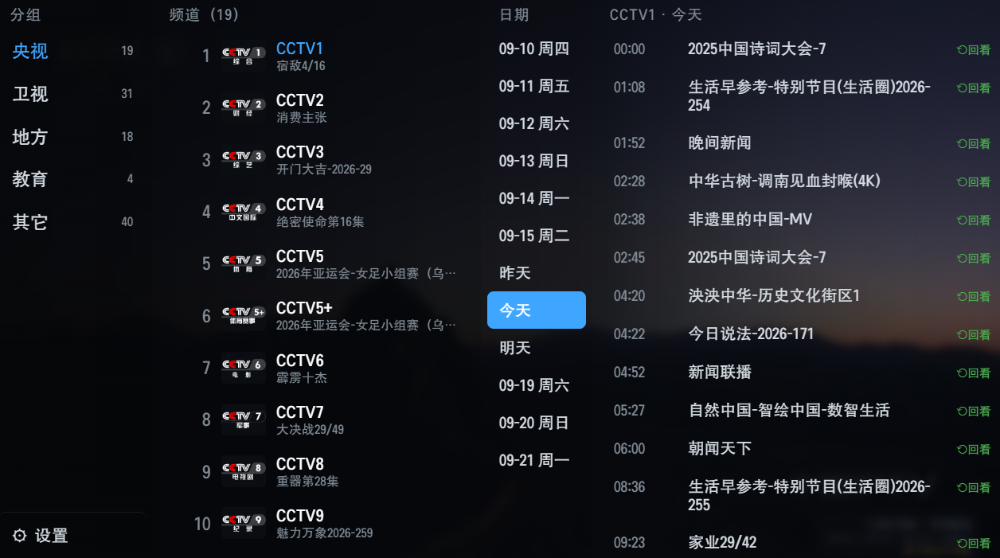
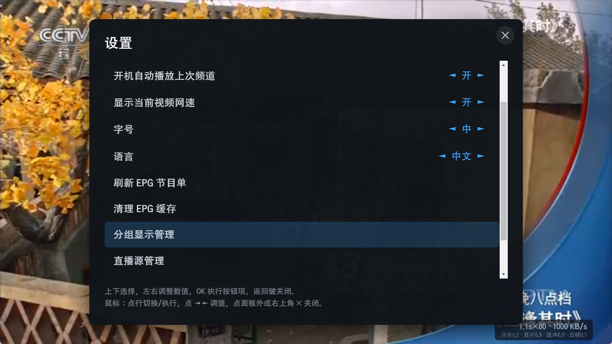
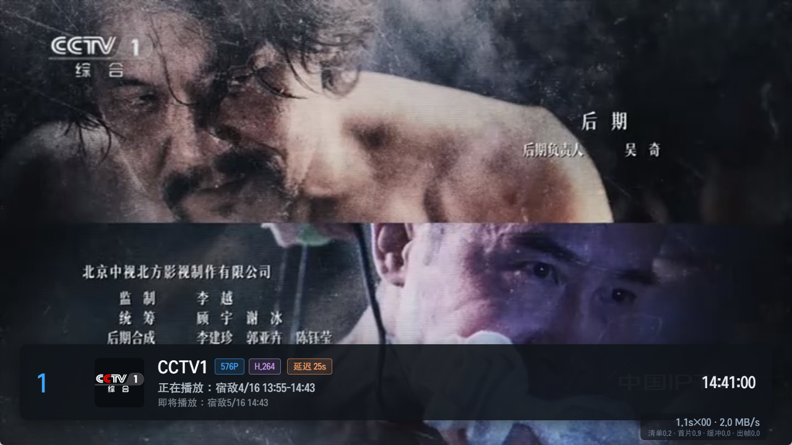

# Qoder IPTV Player for LG webOS

[中文说明](#中文说明)

An open-source M3U / IPTV player for LG webOS TVs (webOS 5.3+, tested on webOS 6 and later), built with Vite and [hls.js](https://github.com/video-dev/hls.js).

**No channels, playlists, programmes or EPG data are included.** You add your own M3U playlist and XMLTV/DIYP EPG sources. Only use content you are legally entitled to access. The app does not bypass accounts, authentication or DRM.

## Screenshots
| Channel menu with EPG and catch-up | Settings | Playback info bar |
| --- | --- | --- |
|  |  |  |

Demo video recorded on a real LG TV: [docs/demo.mp4](docs/demo.mp4)

## Features
- Multiple M3U/M3U8 sources: add, edit, switch, delete; channels merged by group and name
- Four-column channel menu: groups, channels (logo, number, now playing), programmes, dates
- XMLTV and DIYP EPG: now/next and a full-screen programme guide
- Catch-up playback via `catchup` / `catchup-source` / `catchup-days`, with seek and playback speed control
- Fast channel switching: adjacent-channel prefetch and tunable buffering
- Number-key zapping, favourites, aspect ratio, native / hls.js decoder switch, remembers the last channel
- Interface language follows the system (Chinese or English) and can be switched in Settings

## Remote keys
| Key | While playing |
| --- | --- |
| OK | Channel menu |
| ← / → | Switch to the previous / next source of the channel (opens the menu if there is only one) |
| ↑ / ↓, CH± | Previous / next channel |
| Numbers | Go to channel number |
| Red | Programme guide (EPG) |
| Green | Settings |
| Yellow | Add / remove favourite |
| Blue | Source manager |
| INFO | Info bar |
| FF / REW | ±30 s in catch-up |
| Stop / Back | Return to live from catch-up |

## Build
Requires Node.js 18+.
```sh
npm install
npm test          # unit tests
npm run dev       # browser preview at http://localhost:5173 (keyboard emulates the remote)
npm run package   # builds dist/ and creates com.qoder.iptv_<version>_all.ipk
```
In the browser, M3U/EPG requests may hit CORS limits; the dev server provides a local proxy. The webOS app itself has no such restriction.

## Install
- Through [Homebrew Channel](https://github.com/webosbrew/webos-homebrew-channel) / [webOS Dev Manager](https://github.com/webosbrew/dev-manager-desktop) from the webosbrew repository, or
- Download the IPK from [Releases](https://github.com/HCLGitHub/qoder-iptv-releases/releases) and install it with `ares-install --device tv <file>.ipk`.

## License
[MIT](LICENSE). Bundled third-party software: hls.js (Apache License 2.0); see [THIRD-PARTY-NOTICES.txt](THIRD-PARTY-NOTICES.txt).

---

## 中文说明

运行在 LG webOS 电视（webOS 5.3+，主要在 webOS 6 及以上测试）上的开源 M3U / IPTV 播放器，基于 Vite 与 hls.js。

**本应用不包含任何频道、播放列表、节目或 EPG 数据**，M3U 与 EPG 均由用户自行添加。请只使用你有合法权利访问的内容；本应用不绕过账号、鉴权或 DRM。

### 截图
| 频道菜单（EPG / 回看） | 设置 | 播放信息条 |
| --- | --- | --- |
|  |  |  |

真机演示视频：[docs/demo.mp4](docs/demo.mp4)

### 功能
- 多个 M3U/M3U8 源的添加、编辑、切换、删除，按分组 + 名称合并频道
- 四栏频道菜单：分组 ｜ 频道（台标、序号、正在播放）｜ 节目单 ｜ 日期
- XMLTV 与 DIYP EPG：当前/下一节目、全屏节目指南
- 基于 `catchup` / `catchup-source` / `catchup-days` 的回看，支持拖动进度与倍速
- 换台提速：邻台预取与可调缓冲参数
- 数字换台、收藏、画面比例、原生 / hls.js 解码切换、记忆上次频道
- 界面语言跟随系统（中文 / 英文），也可在设置中手动切换

### 遥控键位
| 按键 | 播放中 |
| --- | --- |
| OK | 呼出频道菜单 |
| ← / → | 切换当前频道的上一个 / 下一个源（单源时呼出菜单） |
| ↑ / ↓、频道± | 上 / 下换台 |
| 数字键 | 输入频道号换台 |
| 红 | 全屏节目指南（EPG） |
| 绿 | 设置 |
| 黄 | 收藏 / 取消收藏 |
| 蓝 | 直播源管理 |
| INFO | 信息条 |
| 快进 / 快退 | 回看时 ±30 秒 |
| 停止 / 返回 | 回看时返回直播 |

### 构建
需要 Node.js 18+。
```sh
npm install
npm test          # 单元测试
npm run dev       # 浏览器预览 http://localhost:5173 ，键盘模拟遥控器
npm run package   # 构建 dist/ 并生成 com.qoder.iptv_<版本>_all.ipk
```

### 安装
- 通过 Homebrew Channel / webOS Dev Manager 从 webosbrew 仓库安装；或
- 在 [Releases](https://github.com/HCLGitHub/qoder-iptv-releases/releases) 下载 IPK，用 `ares-install --device tv <文件>.ipk` 安装。

### 许可
[MIT](LICENSE)。随附第三方组件 hls.js（Apache License 2.0），见 [THIRD-PARTY-NOTICES.txt](THIRD-PARTY-NOTICES.txt)。
